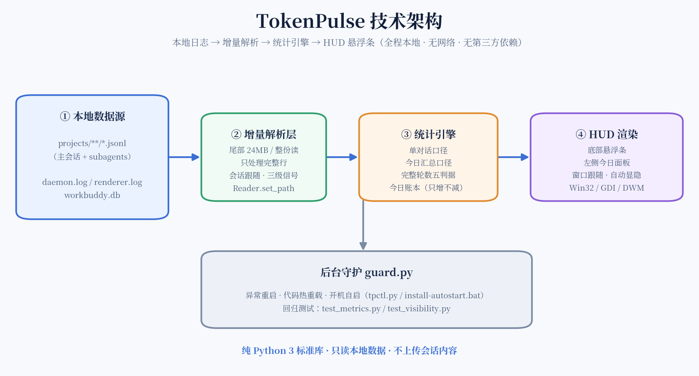

# TokenPulse

**WorkBuddy 本地用量监控 · Windows 桌面 HUD**

TokenPulse 是一款面向 WorkBuddy 的 Windows 桌面用量监控工具。它读取 WorkBuddy 本机保存的会话日志，统计模型调用产生的 Token、积分与缓存数据，并将结果显示在聊天窗口底部；左侧栏另提供当天全部会话的汇总数据。


> **重要：界面同时展示两套统计数据。**
>
> 1. **当前单对话数据**：底部悬浮条，只统计当前窗口正在查看的那一个会话，跨天累计。
> 2. **今日汇总数据**：左侧面板，汇总今天所有会话及其子代理的用量，按本地自然日统计。
>
> 两套数据的文件范围和时间窗口不同，数值通常不会相同。

## 界面预览

### 截图 1：当前对话 + 今日汇总


- **底部悬浮条（当前单对话）**：对话 45 轮、消耗 105.79 分、Token 总计 52.85M、缓存命中 98.5%。
- **左侧面板（今日汇总）**：今日对话 4 轮、今日消耗 2.71 分、今日 Token 1.06M。

### 截图 2：另一对话状态 + 今日汇总


- **底部悬浮条（当前单对话）**：对话 1 轮、消耗 0.00 分、Token 总计 822.7K、缓存命中 95.4%。
- **左侧面板（今日汇总）**：今日对话 4 轮、今日消耗 2.71 分、今日 Token 1.01M。

两张截图来自不同时间点或不同当前会话状态，数值用于说明界面分区与统计口径，不构成同一时刻的数值对账样本。

## 功能

- 当前会话 Token 总量、积分消耗、完整对话轮数与缓存命中率。
- 今日全部会话的轮数、积分消耗和 Token 汇总。
- 扫描主会话与子代理日志，纳入子代理产生的模型用量。
- 根据 WorkBuddy 窗口、当前页面和侧边栏状态显示或隐藏 HUD。
- 多窗口会话绑定；支持通过 `TP_SESSION` 手动固定会话。
- 增量读取日志，降低重复扫描开销。
- 后台守护、异常重启和代码热重载。
- 提供独立统计探针、窗口检查和回归测试脚本。

## 两套数据：范围、来源与计算

### A. 当前单对话数据（底部悬浮条）

**统计范围**：当前 WorkBuddy 窗口正在显示的会话 JSONL 文件：

```text
~/.workbuddy/projects/<项目目录>/<会话UUID>.jsonl
```

**时间范围**：该会话文件中的完整历史，不按日期清零。切换会话后，统计对象切换为新会话，数值重新计算。

| 界面指标 | 数据来源字段 | 计算方式 |
|---|---|---|
| 对话 N 轮 | `conversationRequestId`、消息末条类型、`providerData.usage`、`providerData.error` 等 | 按请求 ID 聚合；满足完整结束条件的请求计 1 轮 |
| 消耗 X.XX 分 | `providerData.rawUsage.credit` | 对当前会话内各模型调用的 credit 求和，显示两位小数 |
| Token 总计 | `providerData.rawUsage.total_tokens` | 对当前会话内各模型调用的 total_tokens 求和，包含输入与输出 Token |
| 缓存命中 XX.X% | `prompt_cache_hit_tokens`、`prompt_tokens` | `Σ prompt_cache_hit_tokens ÷ Σ prompt_tokens × 100%`，先汇总分子和分母再相除 |

**完整对话轮数的判定**：同一个 `conversationRequestId` 的请求，必须同时满足以下条件才计为一轮：

1. 该请求最后一条记录是 assistant 消息；
2. 存在 `providerData.usage`；
3. `providerData.error` 为空；
4. 未被 `resend-fork-notice.editedUserItemId` 标记为作废请求；
5. 不是纯子代理请求。

**积分和 Token 的统计范围比“完整轮数”更宽**。用户中断、回退重发、上下文压缩摘要、自动取标题和后台子代理等调用，可能产生实际用量；这些用量照常累计，但不一定增加完整对话轮数。因此，轮数与消耗不同步属于预期行为。

### B. 今日汇总数据（左侧面板）

**统计范围**：WorkBuddy 本地项目目录下今天有用量记录的所有主会话，以及各会话的子代理日志：

```text
~/.workbuddy/projects/
├── <项目目录>/
│   ├── <会话UUID>.jsonl
│   └── <会话UUID>/
│       ├── subagents/
│       │   └── agent-*.jsonl
│       └── agents/
│           └── ...
```

`tool-results/*.ndjson` 是工具原始返回数据，不作为模型用量账目扫描。

**时间范围**：本地时区当天 00:00 至当前时刻。按每条记录自身的 `timestamp` 归属日期，而不是按文件修改时间或会话创建时间。

| 左侧指标 | 数据来源 | 计算方式 |
|---|---|---|
| 今日对话 | 所有会话及子代理记录中的请求信息 | 按完整对话轮数判据识别；跨文件汇总，纯子代理请求不计轮 |
| 今日消耗 | 所有会话及子代理的 `rawUsage.credit` | 对今天时间窗内的 credit 求和 |
| 今日 Token | 所有会话及子代理的 `rawUsage.total_tokens` | 对今天时间窗内的 total_tokens 求和 |

今日汇总沿用单对话的轮数、积分和 Token 判据，但将统计范围扩展到所有会话，并把时间窗限制为当天。**今日面板不显示缓存命中率**；缓存命中率仅显示在当前对话悬浮条。

#### 今日汇总的去重与账本规则

- 子代理的用量可能只记录在 `subagents/agent-*.jsonl` 中，因此今日汇总必须扫描子代理日志。
- `credit-usage`（`source=team_member`）与子代理日志中的 `rawUsage` 可能代表同一笔费用，不能重复相加；以带 `rawUsage` 的记录为准。
- 跨越午夜的调用，积分和 Token 按各条 `rawUsage` 记录的 `timestamp` 归日；完整对话轮数按请求完成时刻归日。
- 今日账本按会话保存当天已累计数据，采用逐项取最大值的方式更新，避免已删除会话导致已发生用量从当天汇总中消失。
- 今日账本位于运行时 `_tmp/` 目录，不属于发布数据。删除账本会丢失已删除会话对应的历史累计部分。

### 数据读取与刷新

TokenPulse 使用 WorkBuddy 本地数据，不通过 API 重新询价或估算用量。

| 本地来源 | 用途 |
|---|---|
| `projects/<项目>/<会话UUID>.jsonl` | 当前会话消息、请求 ID、Token、积分、缓存字段及请求状态 |
| `projects/<项目>/<会话UUID>/subagents/agent-*.jsonl` | 子代理模型调用用量，主要用于今日汇总 |
| `logs/daemon.log` | 读取 `history-probe` 中的当前会话标识 |
| `logs/renderer.log` | 读取 renderer heartbeat 中的 `currentConversationId` |
| `workbuddy.db` | 查询 `sessions` 表，辅助确定当前会话 |

`timestamp` 按毫秒时间戳处理。`rawUsage` 可能存在于一次请求的多次模型调用记录中；只读取最终消息的 `message.usage` 会遗漏大量调用用量。

**增量读取策略**：会话文件不超过 64 MB 时整份读取；超过时退化为读取尾部 24 MB。增量读取只处理最后一个完整换行，未写完的半行留待下一轮。文件被截断或重写时重新全量读取。

**刷新节奏**：空闲时约每 0.25 秒扫描一次；最近 3 分钟内存在调用时约每 0.15 秒扫描一次。今日账本约每 8 秒节流写入。

## 技术实现

- Python 3 标准库
- Windows Win32 API
- GDI / DWM 窗口绘制与合成
- SQLite3（读取 WorkBuddy 会话索引）
- JSONL 增量解析
- 多线程轮询与窗口跟随

HUD 作为独立窗口绘制，不修改 WorkBuddy 主程序文件。项目面向 WorkBuddy 当前本地数据结构和 Windows 桌面环境。

### 架构流程



本地日志经增量解析层读取，统计引擎按单对话与今日两套口径计算，最终由 HUD 渲染层绘制；后台守护进程负责异常重启、热重载与开机自启。详细实现见 [ARCHITECTURE.md](references/ARCHITECTURE.md)。

## 目录结构

```text
TokenPulse/
├── README.md
├── SKILL.md
├── CHANGELOG.md
├── CONTRIBUTING.md
├── SECURITY.md
├── SUPPORT.md
├── LICENSE
├── LICENSE-STATUS.md
├── .gitignore
├── assets/
│   ├── promo.png
│   ├── architecture.png
│   └── screenshots/
│       ├── conversation-and-today-01.png
│       └── conversation-and-today-02.png
├── docs/
│   ├── DATA-METRICS.md
│   └── REPOSITORY-NOTES.md
├── references/
│   ├── ARCHITECTURE.md
│   ├── SETTINGS.md
│   └── TROUBLESHOOTING.md
└── scripts/
    ├── hud.py
    ├── guard.py
    ├── tpctl.py
    ├── start-hud.bat
    ├── stop-hud.bat
    ├── install-autostart.bat
    ├── uninstall-autostart.bat
    ├── probe.py
    ├── check_hud.py
    ├── check_ghost.py
    ├── render_panel.py
    ├── test_metrics.py
    └── test_visibility.py
```

## 安装与运行

本仓库当前版本以 WorkBuddy Skill 目录形式组织。将仓库中的 `TokenPulse` 目录内容放入 WorkBuddy 的技能目录，使其最终路径类似：

```text
%USERPROFILE%\.workbuddy\skills\tokenpulse\
```

启动：

```bat
cd /d "%USERPROFILE%\.workbuddy\skills\tokenpulse\scripts"
start-hud.bat
```

停止：

```bat
cd /d "%USERPROFILE%\.workbuddy\skills\tokenpulse\scripts"
stop-hud.bat
```

检查窗口：

```bat
python check_hud.py
```

独立核对今日数据：

```bat
python probe.py
```

更多命令、参数与排障说明见：

- [技能说明](SKILL.md)
- [数据口径与算法](docs/DATA-METRICS.md)
- [架构说明](references/ARCHITECTURE.md)
- [参数设置](references/SETTINGS.md)
- [故障排查](references/TROUBLESHOOTING.md)

## 配置

主要通过启动脚本中的环境变量配置，例如：

```bat
set "TP_ONLY_CHAT=1"
set "TP_SESSION="
set "TP_INK=0.70"
set "TP_OPACITY=255"
```

完整配置见 [SETTINGS.md](references/SETTINGS.md)。

## 兼容性与已知限制

- Windows 桌面环境；使用 Win32、GDI 和 DWM。
- 依赖 WorkBuddy 本地日志目录、日志字段和窗口结构。
- WorkBuddy 更新可能改变日志格式、窗口识别或页面布局，需要重新验证。
- 两个 WorkBuddy 窗口并排显示不同对话时，自动会话识别存在边界；可用 `TP_SESSION` 固定会话。
- 锁屏状态下，依赖屏幕像素的页面识别无法正常工作。
- 今日面板的账本用于保留当天已删除会话的历史累计；它不是完整永久归档。

## 隐私与安全说明

- 项目按本地读取方式设计，不需要用户提供 API Key。
- 当前实现读取 WorkBuddy 本地日志、日志文件和 SQLite 会话索引。
- 源码中未设计将会话内容上传到远端服务的业务流程。
- 发布前仍建议自行审查源码、依赖和打包产物；“本地运行”不等于经过第三方安全审计。
- 请勿提交个人会话日志、数据库、访问令牌或真实用户数据。

## 贡献与反馈

欢迎提交问题、兼容性报告和改进建议。提交前请阅读 [CONTRIBUTING.md](CONTRIBUTING.md)，并遵守 [安全问题报告说明](SECURITY.md)。

## 版本

当前整理版本：`1.0.0`。变更记录见 [CHANGELOG.md](CHANGELOG.md)。

## 作者与许可证

作者：陈彦恺 · 版本 1.0.0

本项目采用 [MIT License](LICENSE)，允许自由使用、修改与再分发，条件是保留版权与许可声明。软件按"原样"提供，不附带任何担保。
